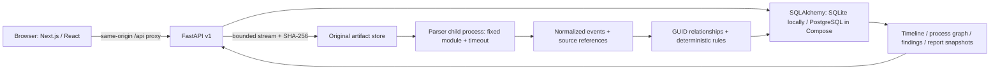

# Architecture · SPECTRE 0.1

This checkpoint implements a bounded, local investigation product. It combines a genuine structured-evidence pipeline with a public synthetic narrative and an authenticated analytical workspace. It does not implement every item in the master brief.

## Services and development

- `frontend/`: Next.js App Router, React strict TypeScript, Tailwind 4 with custom tokens, shadcn-style owned Button/Dialog primitives on Radix, Motion, TanStack Query/Table/Virtual and lazy React Flow.
- `backend/spectre/`: FastAPI routes and authorization (`main.py`, `auth.py`), typed requests (`schemas.py`), SQLAlchemy models, storage/derivation services, pure parser, deterministic rules, explicit initialization/recovery CLI.
- `backend/alembic/`: concrete initial migration. Startup never creates tables. `spectre.cli init` runs migrations as an explicit deployment step.
- `datasets/synthetic/`: real parser inputs and independent ground truth.
- `scripts/`: Windows development launcher, disposable browser-test API, reproducible small benchmark.
- Compose: PostgreSQL 18, initialization task, unprivileged API, frontend. Only the frontend binds a host port, on loopback. No paid services.

SQLite is an intentional native-development adapter because Docker and PostgreSQL are not installed on the audited machine. PostgreSQL compatibility is represented by SQLAlchemy types, concrete migrations, driver and Compose/CI configuration; it is not locally verified. Timestamp columns contain fixed-width UTC ISO strings for identical lexical ordering across adapters. Native timestamptz and database-specific histogram aggregation can be introduced with a measured migration later.

## Data model

| Table | Invariant / purpose |
| --- | --- |
| users, sessions | Argon2 password hashes, hashed opaque tokens, expiry |
| investigations | Single owner is the authorization boundary; private demo copies are still private |
| evidence | Original filename, size, streamed SHA-256, safe storage key, source/acquisition data, parser and outcome; unique case/hash |
| custody_events | Insert-only through application services, actor, action, timestamp, details |
| parsing_jobs | Explicit processing/completed/failed state and completion/error metadata |
| events | Stable UUID5 and canonical fingerprint, source, UTC/original time, precision, host/account, process identities, category/action, parsed fields, raw record |
| event_sources | Additional original artifact/record references for deduplicated events |
| entities | Typed discriminator: host, identity, process, file, endpoint, evidence; unique case/kind/key |
| relationships | Typed edge plus original event and evidence foreign keys; deterministic UUID5 |
| detection_rules, findings | Versioned rule definitions, rationale, limitations, source event IDs, review state and notes |
| annotations | Owned-case event notes and bookmarks, author and creation time |
| reports | Persisted complete JSON snapshot and content hash; exports read the stored snapshot |
| audit_events | Append-only application activity trail without raw evidence in operational logs |

Events have composite `(case_id,timestamp,id)` and `(case_id,process_key)` indexes. Entity subtypes share one typed table; separate host/file databases and graph storage are unnecessary at this scale. No graph database or search cluster is present.

## Ingestion transaction

1. Authenticate, authorize case, validate basename, format and optional acquisition time.
2. Stream at most 20 MiB to a generated exclusive file; calculate SHA-256 while writing. Client-provided paths are never storage paths.
3. Under the single-process ingestion lock, deduplicate case/hash. Preserve new originals read-only and commit evidence, custody import and processing job.
4. Run the fixed Python parser module in a child process. It writes normalized JSONL to a generated private temporary file. A 20-second parent deadline kills a timed-out child. POSIX additionally bounds child CPU and address space; Windows uses input/record/deadline caps.
5. In a separate database transaction, normalize/deduplicate events, keep all source references, derive explicit entities/edges and documented rule matches, then commit ready/completed plus custody. A failure rolls back all derived rows and records failed state while retaining the original.
6. Remove the generated parser output. Original downloads rehash the source and record access; mismatches return 409.

There is no Redis queue in this checkpoint. Imports wait for bounded processing, and the UI shows an indeterminate state. Run one API worker. Multiple API processes, distributed locks, crash-safe resumable queue jobs and asynchronous progress are future work. Interrupted jobs are explicitly marked failed with `spectre.cli recover` after stopping active processing; this preserves originals and custody.

## Derivation boundaries

Process GUID + host is the primary identity. PID-only creations include time in their identity; PID-only activity does not establish relationships. Parent process time must precede child time. Rule evaluation is deterministic and does not execute commands or decode payloads. Host/account association is an observation, not a confirmed attack chain. ATT&CK labels provide investigation context, not proof of technique execution. See [artifact contract](docs/ARTIFACT_FORMATS.md).

Event pages are limited to 250 by default, 500 maximum. Raw records load only on inspection. SQL builds case density. Graph queries cap at 150 entities/500 relationships and signal truncation; layout is stable, with visual grouping of repeated edges while source edges remain stored. The event table uses virtualization. Current density uses bounded per-bin indexed SQL count queries, suitable for the release limits but requiring measurement before expansion.

## Reproducibility

Stable event IDs derive from case + canonical fingerprint. Reports persist evidence inventories, custody, normalized events, source mappings, rule versions, findings, notes, assumptions and export time. Repeated JSON downloads of the same stored report are byte-identical. A new report reflects the current case and has a new export time. PDF is a readable summary with the first 100 events; JSON contains every stored event. Original source files remain separately downloadable.

The public demo endpoint can only select a case owned by the reserved `__public_demo__` identity, whose randomly generated password cannot be used through login. A normal user's `is_demo` flag never grants public visibility.
