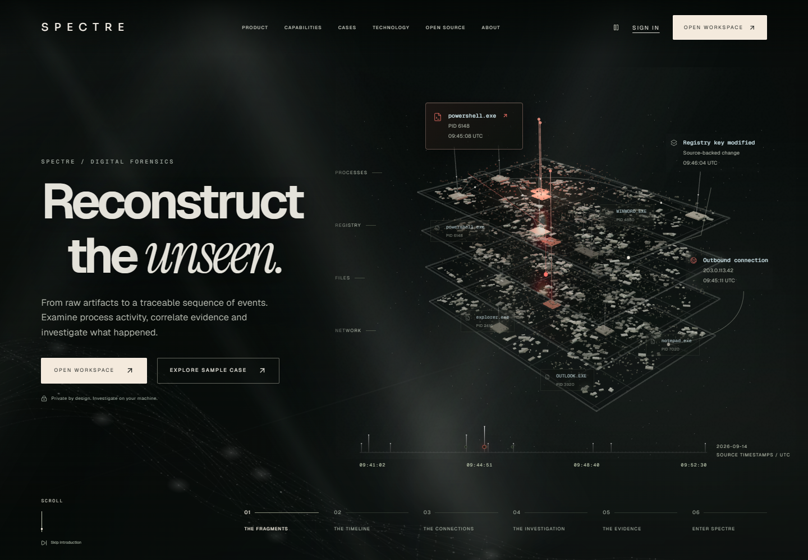
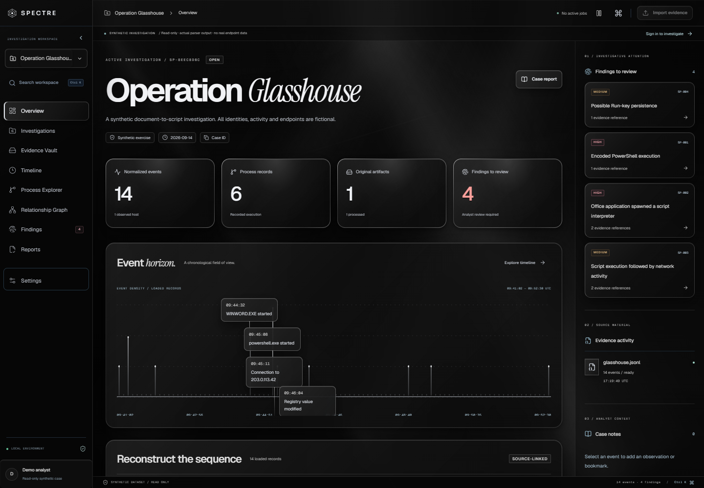
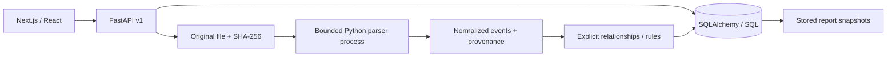
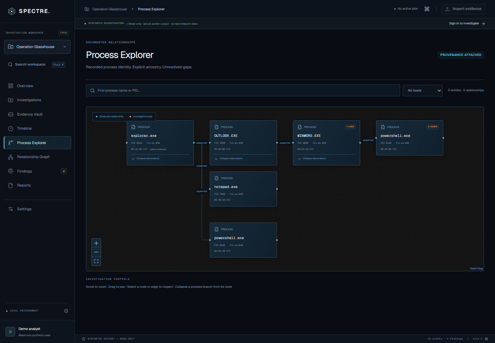

# SPECTRE

**Reconstruct the unseen.**

SPECTRE is a local-first digital forensic investigation platform that turns supported endpoint records into an inspectable chronology, explicit process relationships and evidence-backed investigative leads. Create a private case, preserve and hash an original artifact, inspect normalized events, review documented rule matches, annotate the evidence and export a stored report snapshot. The core requires no AI key or cloud account.

The UI implements the supplied 15-screen Obsidian Forensic Intelligence concept board: living evidence hero, six connected narrative chapters, terrain-based local authentication and a dense investigative workspace. Backend capabilities remain a local engineering checkpoint: binary EVTX support and distributed workers are not implemented. Project licensing is pending owner selection.





Route comparison: [visual reinvention plan](VISUAL_REINVENTION_PLAN.md). Implemented stages and checks: [redesign progress](REDESIGN_PROGRESS.md). Desktop/mobile screenshots and measured browser results: [redesign artifacts](docs/redesign/README.md).

## Run locally on Windows

Prerequisites: Python 3.12, Node.js 24 and npm. Commands run from the repository root in PowerShell. Docker is optional.

```powershell
python -m venv .venv
.\.venv\Scripts\python.exe -m pip install -r backend\requirements-dev.lock
npm ci --prefix frontend
.\.venv\Scripts\python.exe -m spectre.cli init
```

The last command runs migrations, asks you to choose a local password and imports the public synthetic case through the real parser. It is repeatable and does not reset existing cases. Start the API and frontend together:

```powershell
.\scripts\dev.ps1
```

Open **http://127.0.0.1:3000**. The read-only demo is **http://127.0.0.1:3000/workspace?demo=1**. Sign in at `/workspace` as `analyst` with your chosen password. For the evaluation instance initialized during development, the generated password is in the ignored `data/local-login.txt` file.

If script execution is restricted, run two terminals:

```powershell
.\.venv\Scripts\python.exe -m uvicorn spectre.main:app --host 127.0.0.1 --port 8100 --no-access-log
```

```powershell
Set-Location frontend
npm run dev
```

Use `127.0.0.1`, not a different hostname, because mutation origins are checked exactly. If ports are occupied, `scripts/dev.ps1 -ApiPort 8102 -WebPort 3002` configures both sides. The launcher stops only the API process it starts when the frontend exits. OpenAPI: http://127.0.0.1:3000/api/docs.

## WSL2 / Linux

```bash
python3.12 -m venv .venv
.venv/bin/python -m pip install -r backend/requirements-dev.lock
npm ci --prefix frontend
.venv/bin/python -m spectre.cli init
.venv/bin/python -m uvicorn spectre.main:app --host 127.0.0.1 --port 8100 --no-access-log
# In another terminal, from the repository:
npm run dev --prefix frontend
```

Native Windows is the locally verified environment. WSL2 and Compose configuration are supplied but not exercised on this machine.

## Evidence workflow

1. Create an investigation, or choose **Import demo case** for a private working copy of Operation Glasshouse.
2. In **Evidence Vault**, import `datasets/synthetic/glasshouse.jsonl` or a file matching the [documented structured format](docs/ARTIFACT_FORMATS.md). Supported extensions: JSON, JSONL, CSV.
3. Inspect its SHA-256, parser version, outcome and custody history. **Verify & download original** rehashes the stored artifact before downloading.
4. Open **Timeline**. Filter source/host/account, zoom and pan, select a time point or event row, inspect raw fields and provenance, add a note or bookmark. UTC normalization is distinct from optional local display.
5. Follow explicit parent GUIDs in **Process Explorer**. Inspect edges in **Relationship Graph** to see their source events.
6. Review **Findings**. Read the rationale and limitations, inspect supporting events, then confirm or reject a lead with notes.
7. In **Reports**, create a snapshot and download JSON or PDF. The stored snapshot does not change when the case is subsequently edited.

The public demo is read-only. Importing a fresh private demo case resets the exercise without deleting previous custody history. The fixture includes 14 events, six distinct process instances and four rule matches, including a benign PID-reuse control. See [dataset notes and ground truth](datasets/synthetic/README.md).

## Feature status

| Capability | Status in this checkpoint |
| --- | --- |
| Interactive landing narrative and persistent workspace navigation | Implemented |
| Local authentication and case-owner checks | Implemented; single analyst per case |
| Case creation/listing and metadata/status API | Implemented; status editing also available in overview |
| Streamed SHA-256 import, original storage and custody history | Implemented within documented local threat model |
| Flat Sysmon/Security-style JSON/JSONL, normalized JSON/CSV | Implemented for documented fields and IDs |
| Binary EVTX, nested event exports, disk images | Not implemented; rejected |
| Time tracks, density, filters, cursor pages, virtual event table | Implemented with explicit dataset/page limits |
| GUID-based process/relationship graph, collapse, search, provenance | Implemented; capped graph and partial advanced filtering |
| Four deterministic rules, review notes and event bookmarks | Implemented |
| Stored JSON report and PDF summary | Implemented; PDF timeline limited to first 100 events |
| PostgreSQL migrations, Docker Compose and CI workflow | Supplied; local PostgreSQL/Compose not verified |
| Redis jobs, collaborative roles, saved filters, AI, Plaso | Planned |

## Architecture



The native development adapter uses SQLite; Compose uses PostgreSQL 18. There is no graph database, search cluster, external telemetry, AI dependency or queue in this initial release. Imports are bounded synchronous jobs, and the API must run with a single worker. Details: [architecture](ARCHITECTURE.md), [API contract](docs/API_CONTRACT.md), [design system](DESIGN_SYSTEM.md).



## Tests and builds

```powershell
.\.venv\Scripts\python.exe -m pytest -q backend/tests
.\.venv\Scripts\python.exe -m ruff check backend
npm run typecheck --prefix frontend
npm run lint --prefix frontend
npm test --prefix frontend
npm run build --prefix frontend
Set-Location frontend
npx playwright install chromium
npm run test:e2e
```

API tests apply real Alembic migrations to disposable databases. Browser tests start an independent API/database on port 8101 and Next.js on port 3100; they do not modify the analyst's cases. They cover public/private flows, import → note → finding review → report export, responsive navigation and automated axe checks of core screens. See [implementation status](IMPLEMENTATION_STATUS.md) for executed results and known verification limits.

A small benchmark runs the actual HTTP import handler with a disposable SQLite database:

```powershell
.\.venv\Scripts\python.exe scripts\benchmark.py
```

The recorded single local run imported 1,000 synthetic file-category records in **0.756 s** and returned a 250-event page in **17.16 ms**. This is a narrow developer benchmark, not an EVTX, graph-heavy or production throughput claim. Full environment and artifact size: [benchmark.json](docs/benchmark.json).

## Optional PostgreSQL / Compose

Install Docker Desktop with WSL2 support yourself if desired; it was unavailable during local verification. Copy `.env.example` to `.env`, set a randomly generated URL-safe database password and a 12+ character initial analyst password, then:

```powershell
docker compose up --build
```

Compose waits for database health, runs the migration/demo initialization task, then starts the API and web server. Named volumes preserve originals and database data. Only `127.0.0.1:3000` is published. Do not use `docker compose down -v` on an evidence-bearing instance. The supplied CI workflow includes a PostgreSQL migration/import check; no remote CI run is claimed.

## Security and limitations

Evidence is untrusted. No artifact content is executed or sent to an external model. The analyst's OS account and database administrator remain trusted. Read-only files and application custody history are not tamper-proof. Original downloads verify hashes, and every private API checks case ownership. Full boundaries, parser limits and hardening work are documented in [SECURITY.md](SECURITY.md).

The supplied workspace is inside OneDrive. Before ingesting sensitive real evidence, configure an access-controlled, non-synced local storage location and database. SPECTRE does not upload evidence, but OS sync and backup software operate outside its control.

Current limits: 20 MiB/file, 10,000 records/file, 20,000 events/case, 20-second parser deadline, 150 graph entities/500 relationships, single API process. Unsupported input is rejected or retained with a failed processing record. Interrupted jobs can be marked failed after stopping active processing with `python -m spectre.cli recover`.

## Development direction and licensing

See [ROADMAP.md](ROADMAP.md) and [IMPLEMENTATION_STATUS.md](IMPLEMENTATION_STATUS.md). Research and compatibility decisions are recorded in [reference notes](docs/RESEARCH.md); direct dependency licenses are listed in [third-party notices](docs/THIRD_PARTY.md). The project license has deliberately not been selected on the owner's behalf. Add the intended license before publishing it as open source; dependency licenses continue to apply.
